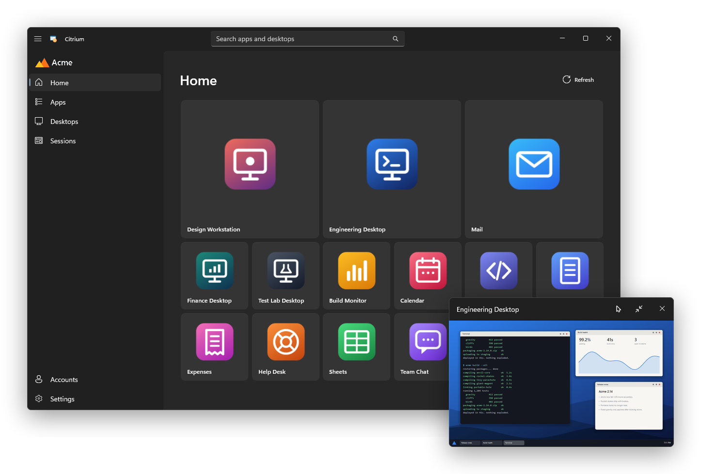
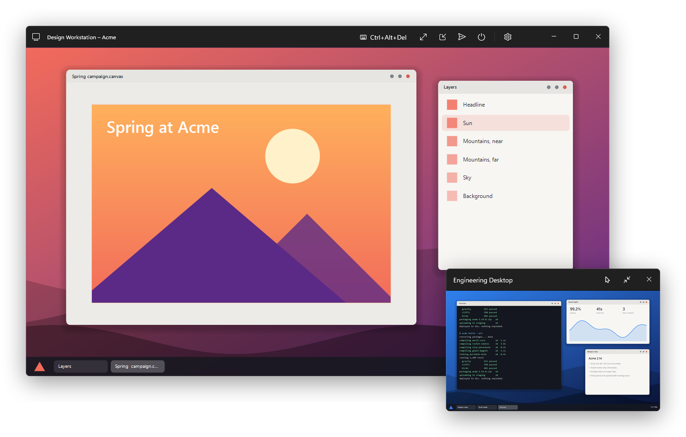
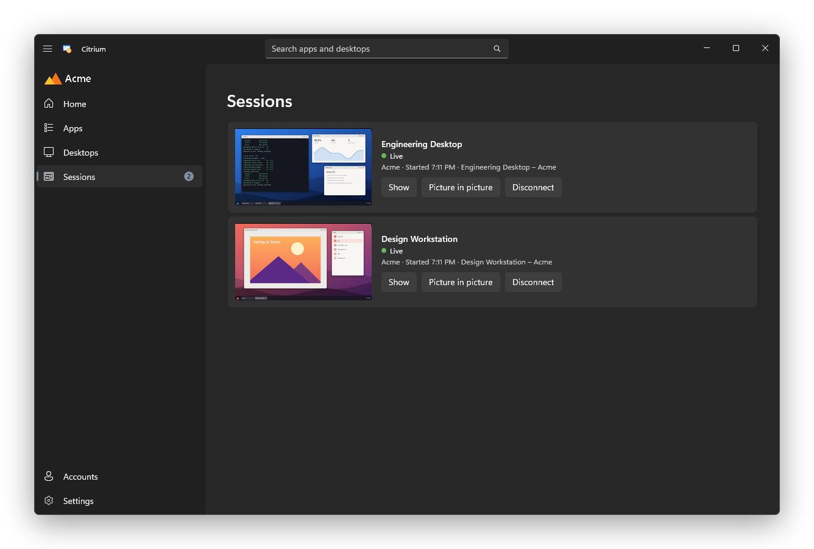
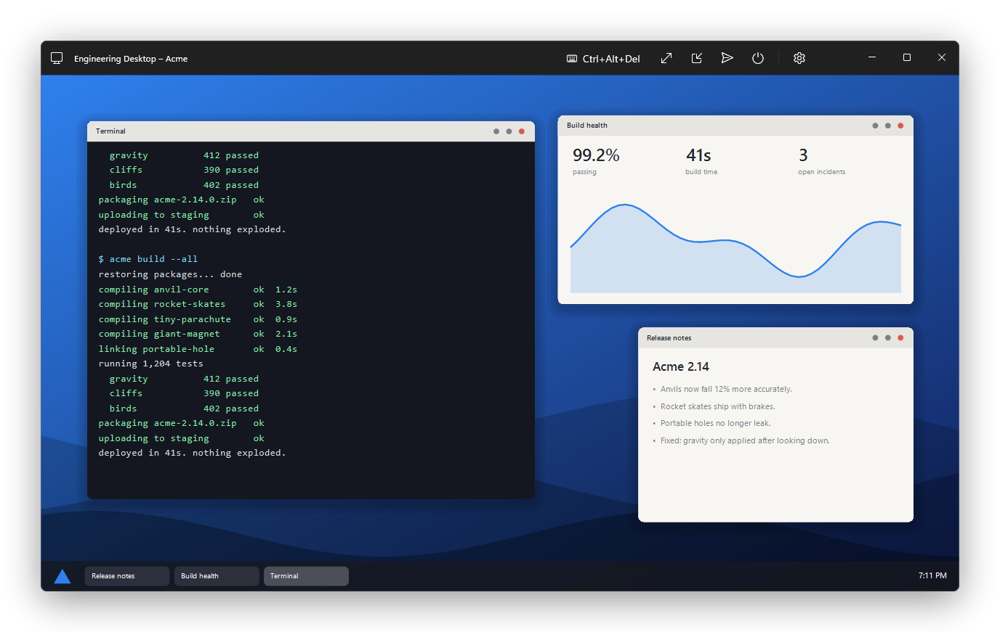
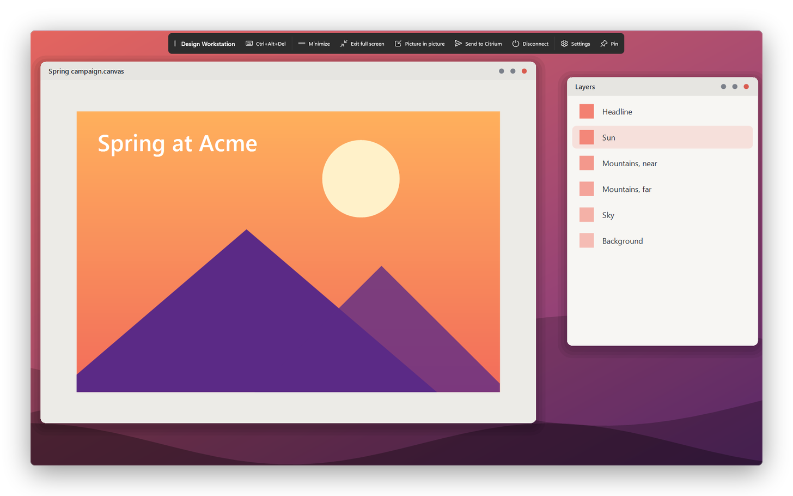

# Citrium

Your Citrix desktops and apps, with picture in picture, live previews and a better full-screen toolbar. You sign in the same way as before.

<picture>
  <source media="(prefers-color-scheme: light)" srcset="docs/screenshots/hero-light.png">
  
</picture>

**[Download Citrium](https://github.com/0dm/citrium/releases)** for Windows 10 (2004 or later) or Windows 11, x64 or ARM64.

## Picture in picture

Shows a live view of a desktop in a small window on top of everything else. It can open automatically when you switch away. Scroll over it to change its opacity, or turn on ghost mode to click through it.

<picture>
  <source media="(prefers-color-scheme: light)" srcset="docs/screenshots/pip-light.png">
  
</picture>

## Sessions

Lists every running session with a live preview, including ones started outside Citrium. If a desktop disconnects, Citrium notifies you and you can reconnect in one click. Send to Citrium hides a desktop without disconnecting it.

<picture>
  <source media="(prefers-color-scheme: light)" srcset="docs/screenshots/sessions-light.png">
  
</picture>

## Desktop window

Each desktop remembers its size and position. You can change scaling, audio and other settings from the title bar while connected.

<picture>
  <source media="(prefers-color-scheme: light)" srcset="docs/screenshots/desktop-light.png">
  
</picture>

## Full screen

This toolbar is actually why I built Citrium. Citrix's kept vanishing, and it got annoying. Rest the pointer at the screen edge to bring it up. Dock it to any edge or float it.

<picture>
  <source media="(prefers-color-scheme: light)" srcset="docs/screenshots/fullscreen-light.png">
  
</picture>

## Other features

- Add several accounts and search all of them with Ctrl+E.
- Pin favorites, and open them from the tray, the taskbar's jump list or a desktop shortcut.
- Open a desktop automatically when Citrium starts with Windows.
- Home shows your apps as tiles that shrink and rearrange as you add more.

## Install

Download `Citrium-<version>-x64.msi` (or `-ARM64.msi`) from [Releases](https://github.com/0dm/citrium/releases) and run it. It installs for your user only, so it doesn't need administrator rights. Citrium updates itself after that. Windows may show a warning because the installer isn't code signed yet.

Then, in Citrium:

1. Open **Settings** and select **Install Citrix Workspace**. If you don't see the button, it's already installed.
2. Restart Citrium.
3. Open **Accounts** and add your Citrix StoreFront store or Citrix Gateway address, over HTTPS.

Uninstalling leaves your settings and saved sign-ins in `%LocalAppData%\Citrium`. Delete that folder to remove them too.

## Build

You need the .NET 10 SDK.

```powershell
dotnet publish src/Citrium/Citrium.csproj -c Release -p:Platform=x64 -r win-x64 -o artifacts/Citrium-win-x64
```

Then run `artifacts/Citrium-win-x64/Citrium.exe`. For ARM64, use `-p:Platform=ARM64 -r win-arm64`.

To build the installer, then run the tests:

```powershell
dotnet build installer/Citrium.Installer.wixproj -c Release -p:Platform=x64
dotnet test tests/Citrium.Tests/Citrium.Tests.csproj
```

Pushing a tag like `v0.2.0` builds both versions and publishes them, with their installers, as a GitHub release.

### Try it without Citrix

The Demo build runs without Citrix or an account, using a made-up company and fake desktops. The screenshots here come from it. It stores its data separately and can run alongside the real app.

```powershell
dotnet build src/Citrium/Citrium.csproj -c Demo -p:Platform=x64
```

Then run `Citrium.exe` from `src/Citrium/bin/x64/Demo/net10.0-windows10.0.22621.0`.

## Known limitations

- Picture in picture is view-only. Go back to the full window to use the desktop.
- Live previews and picture in picture stop updating while a desktop is minimized.
- A desktop can move between screens, but can't span several at once.
- Stores on the newer Citrix Cloud platform (`*.cloud.com`) only work if they still expose the classic StoreFront endpoints.
- Favorites are stored locally and don't sync with your store.
- Disconnect a desktop in Citrium before opening it in Citrix's own viewer, or Citrium will take it over.
- Citrium can't tell a dropped connection from signing out inside the desktop, so both offer to reconnect.

## Privacy

Citrium talks to your Citrix stores. Unless you turn it off in Settings, it also asks GitHub once a day whether there's a newer version. When there is, it downloads the installer from the release on GitHub, checks it against the SHA-256 digest GitHub lists, and installs it silently once no sessions are open. Citrium closes and reopens to do this. A copy unzipped from a release doesn't update itself.

## License

[Apache License 2.0](LICENSE)

Citrium is an independent project and isn't affiliated with or endorsed by Citrix. Citrix and related names are trademarks of their respective owners.
